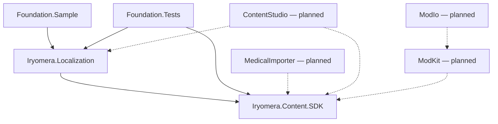

# ADR 0001: Portable foundation and project boundaries

Status: accepted for Phase 1, package version 0.1.0 / exchange schema 1.0.0.

## Context and decision

The game is closed source and uses Godot 4. Public tooling must run independently, offline, on Windows and Linux. Phase 1 therefore ships only two packable libraries, one console example and one test project. No Godot package or closed game data enters this repository.

SDK uses System.Text.Json plus NuGet.Versioning. Localization adds SmartFormat and the .NET localization abstraction, without ASP.NET hosting. JsonSchema.Net is a test-only independent schema evaluator. Libraries produce NuGet packages and XML API documentation. Schema files are included in the SDK package. `CS1591` is suppressed for self-descriptive contract properties; semantic details and units are documented in the format reference.

The later importer owns normalization and review staging, Studio owns EF/SQLite and the Blazor UI, ModKit owns archive/assets/install validation, and ModIo owns optional remote distribution. There are no stub implementations for these phases. CI and the sample run without credentials or live medical sources.

## Data boundaries

- Content IDs use lowercase namespace/local-name pairs. Display text belongs to separate language catalogs and does not affect IDs or save games.
- All twelve definition kinds have a common versioned metadata header and distinct C# types. Phase 1 deliberately does not invent clinical criteria or type-specific assertions unsupported by source data. Additive attributes may be introduced with schemas/tests later.
- Relations are independent assertions with their own IDs, versions and provenance. `kind` determines allowed source and target types. A missing relation means unknown, not a negative assertion. No probability is inferred.
- Definition and relation provenance apply to the complete assertion. Classifications carry their own provenance. Facts from different sources must be kept as separate assertions; a future field-level merge must preserve all supporting lineage rather than silently replacing it.
- Gameplay has a separate collection and no clinical provenance. Rarity, severity, difficulty and success are explicitly normalized simulation values; time is seconds, costs are abstract game units, resources are abstract named quantities.
- Review starts unreviewed. Approval/rejection requires reviewer identity and timestamp. Validation is a technical check, not medical approval. The SDK neither grants approval nor implements authentication/authorization; the later editor must own these workflows.

## Dependency graph

Callers pass a root package and the complete installed dependency closure to validation. No resolver downloads content. Each namespace has one package owner. Content definition and relation IDs share a global uniqueness domain; package IDs have a separate identity domain. References can see the owning package and transitive declared dependencies only. Version ranges use NuGet syntax, not npm syntax. Missing packages, incompatible versions, cycles, duplicate packages and undeclared cross-package references are errors.

Validation returns stable error codes, an assertion/path context and an English developer message. Future tools should localize the code with message parameters instead of exposing implementation messages as their primary UI. JSON parsing failures are `JsonException`; I/O errors and cancellation propagate normally. Runtime nulls in non-nullable contracts receive diagnostics before semantic validation.

## Consequences

Local game adapters can consume packages with no database or distribution dependency. Schema and package versioning are distinct; before a breaking data change, add an ADR, version and migration plan. Mod manifests here are portable metadata contracts, not proof that a ZIP or referenced asset is safe. ZIP limits, model inspection, overrides, asset footprints and interactions are Phase 4 work. Unknown future definition kinds fail explicitly rather than being silently dropped.

## Official implementation references

Consulted during Phase 1 implementation (2026-10-16):

- System.Text.Json polymorphic contracts: https://learn.microsoft.com/en-us/dotnet/standard/serialization/system-text-json/polymorphism
- .NET SDK installation: https://learn.microsoft.com/en-us/dotnet/core/install/
- SmartFormat official repository/wiki: https://github.com/axuno/SmartFormat and https://github.com/axuno/SmartFormat/wiki (implementation additionally checked against the pinned package's XML API docs).
- NuGet version range behavior: https://learn.microsoft.com/en-us/nuget/concepts/package-versioning#version-ranges

No mod.io API or medical source integration was implemented in this phase; their current documentation and licenses must be checked when those phases begin.
