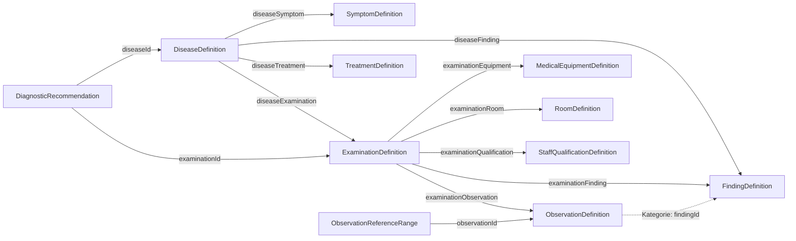

# Untersuchungs- und Diagnosemodell

> Ergänzende deutsche Übersetzung und Übersicht. Maßgeblich ist die [englische Modell- und Formatreferenz](diagnostic-content.md). Änderungen an Verhalten oder Verträgen werden zuerst dort dokumentiert und anschließend hier nachgeführt.

Stand: Content SDK 0.4.0, Austauschformat `schemaVersion: "1.0.0"`.
Diese Übersicht beschreibt die implementierten Inhaltsverträge und den geplanten Ablauf im privaten Spiel. Die englische [Formatreferenz](diagnostic-content.md), [ADR 0008](architecture/0008-diagnostic-content.md) und die [JSON-Schemas](../schemas/v1/) enthalten die technischen Details.

## Grundmodell

Eine Untersuchung wird einmal im gemeinsamen Katalog definiert. Viele Krankheiten können dieselbe Untersuchung referenzieren. Krankheiten besitzen keine eingebetteten Kopien von Untersuchungen. Eine Untersuchung kann mehrere Beobachtungsparameter liefern; derselbe Parameter kann von mehreren Untersuchungen referenziert werden.

| Vertrag | Bedeutung | Abgrenzung |
| --- | --- | --- |
| `DiseaseDefinition` | Identität und Klassifikation einer Krankheit | Manifestationen und Untersuchungen werden über eigenständige Beziehungen zugeordnet. |
| `SymptomDefinition` | Subjektiv berichtete Beschwerde | Beispielsweise berichtet ein Patient Schmerzen. |
| `FindingDefinition` | Objektiv festgestellter Befund | Beispielsweise stellt ein Arzt Druckschmerz fest. |
| `ExaminationDefinition` | Wiederverwendbare Untersuchung | Beschreibt die Handlung, etwa eine Messung oder Bildgebung. |
| `ObservationDefinition` | Definition eines Messparameters oder qualitativen Ergebnisses | Beschreibt beispielsweise den Parameter CRP; der konkrete Patientenwert gehört zum Spielzustand. |
| `TreatmentDefinition` | Behandlung oder medizinische Maßnahme | Krankheit und Behandlung bleiben getrennte Definitionen. |
| `DiagnosticRecommendation` | Optionale, belegte Empfehlung für einen Krankheitskontext | Enthält Referenzen und Review-Metadaten; daraus folgt kein fest auszuführender KI-Ablauf. |

Die medizinischen Begriffe erläutern die Bedeutung der Typen. Sie legen keine Krankheitszuordnung, Referenzwerte oder Behandlungsempfehlung fest.



Die beschrifteten durchgezogenen Verbindungen zwischen Definitionen werden als eigene `ContentRelation`-Datensätze gespeichert: `id`, `version`, `kind`, `fromId`, `toId` und `provenance`. Referenzbereiche und Empfehlungen sind ebenfalls eigenständige Datensätze. Die gestrichelte Verbindung ist eine optionale Kategorienreferenz.

`examinationPrerequisite` verbindet eine Untersuchung mit der Untersuchung, die zuerst erforderlich ist. Die Richtung lautet **abhängige Untersuchung → Voraussetzung**. Zyklen sind ungültig. Eine `diseaseExamination`-Beziehung ist eine Zuordnung; die zusätzliche Bedeutung einer Empfehlung steht im eigenen `DiagnosticRecommendation`-Vertrag.

## Ergebnisse und Patientenkontext

`ObservationDefinition.result` ist eine optionale `ObservationResultDefinition`:

| `valueKind` | Beschreibung |
| --- | --- |
| `numeric` | Numerischer Parameter, optional mit exaktem `unitCode`. |
| `categorical` | Ergebnis aus benannten Kategorien mit stabilen Schlüsseln; eine Kategorie kann auf einen Befund verweisen. |
| `boolean` | Wahr/Falsch-Ergebnis. |
| `text` | Textuelles Ergebnis; Spieltexte werden über Lokalisierungsschlüssel bereitgestellt. |

Ein vorhandener LOINC-Beobachtungscode ohne `result` bleibt gültig. Er wird durch den Import weder zur spielbaren Untersuchung noch zu einem klinisch interpretierten Messwert.

Beispiel eines **Ergebnisdeskriptors**, aus der synthetischen Beobachtung `diagnostics_demo:sample_index`:

```json
{
  "valueKind": "numeric",
  "categories": [],
  "patientContextKeys": ["diagnostics_demo.patient.group"],
  "unitCode": "1"
}
```

`1` bezeichnet hier eine dimensionslose Einheit. Das Objekt definiert den Parameter; es enthält keinen gemessenen Patientenwert. Einheiten werden exakt verglichen, vorzugsweise mit UCUM-Codes. Eine automatische Umrechnung ist nicht implementiert.

`PatientContextCriterion` enthält einen stabilen `factorKey` und genau eine Bedingungsart: numerische Grenzen, eine Kategorie oder einen booleschen Wert. Mehrere Kriterien in `appliesWhen` gelten gemeinsam. Bei Referenzbereichen und simulierten Beobachtungsverteilungen müssen die Faktoren vom Ergebnisdeskriptor in `patientContextKeys` deklariert sein. Die Bedeutung und Bereitstellung dieser Patientenfaktoren muss das konsumierende Spiel festlegen.

`ObservationReferenceRange` ergänzt einen numerischen Parameter um Einheit, mindestens eine Grenze, optionalen Kontext und Herkunft mit Evidenz. Reale medizinische Referenzbereiche benötigen nachvollziehbare Quellen und fachliche Prüfung. Grenzen werden nicht aus Namen, LOINC-Codes oder Spielwahrscheinlichkeiten abgeleitet.

`DiagnosticRecommendation` enthält `diseaseId`, `examinationId`, optionale `contextDefinitionIds`, `appliesWhen`, einen optionalen `rationaleKey` sowie Herkunft und Evidenz. Kontextdefinitionen können Symptome, Befunde und Beobachtungen sein.

## Medizinische Aussagen und Spielparameter

| Medizinische Inhaltsdaten | Getrennte Simulationskonfiguration |
| --- | --- |
| Definitionen, Klassifikationen und belegte Beziehungen | `SimulatedObservationDistribution`: erfundene Wertebereiche, Kategoriegewichte, Wahr-Wahrscheinlichkeit oder Textschlüssel |
| Referenzbereiche und Untersuchungsempfehlungen mit Evidenz | `SimulatedManifestation`: Auftretenswahrscheinlichkeit und Sichtbarkeit von Symptomen/Befunden |
| Quelle, externe Kennung, Quellenversion, Lizenz, Importzeitpunkt und Review | `ExaminationResultPolicy`: Sichtbarkeit und Wiederholungsregel |
| Fachliche Bedeutung von Messparametern und Kategorien | `GameplayBalance`: Kosten, Untersuchungs-/Behandlungsdauer, Schwierigkeit, Erfolg und Ressourcenmengen |

Die ersten drei Simulationsverträge stehen unter `ContentPackage.diagnosticSimulation` und tragen ausdrücklich `simulationOnly: true`. Allgemeines Balancing steht unter `gameplay`. Medizinische Referenzbereiche und Empfehlungen stehen separat unter `referenceRanges` und `diagnosticRecommendations`.

Beispiel einer **frei erfundenen Spielverteilung** aus derselben synthetischen Beispieldatei:

```json
{
  "schemaVersion": "1.0.0",
  "simulationOnly": true,
  "id": "diagnostics_demo:distribution_amber_sample_index",
  "version": "1.0.0",
  "diseaseId": "diagnostics_demo:amber_condition",
  "observationId": "diagnostics_demo:sample_index",
  "categoryWeights": {},
  "numericMinimum": 10,
  "numericMaximum": 14
}
```

Diese Zahlen sind Spielparameter, keine medizinischen Referenzwerte oder aus einer Datenquelle importierte Häufigkeiten. Der Vertrag legt noch keinen Zufallsalgorithmus fest. Sichtbarkeit kann `initiallyVisible`, `afterExamination` oder `hidden` sein. Standardmäßig gilt `untilPatientStateChanges`; `afterInterval` erfordert ein positives Intervall in simulierten Sekunden.

## Komponenten und geplanter Patientenablauf

| Komponente | Verantwortung |
| --- | --- |
| `Iryomera.Content.SDK` | Engine-unabhängige Definitionen, Austauschformate, Referenzen und Validierung. |
| `Iryomera.MedicalImporter` | Originale Quelldaten und Aussagekontexte erhalten; keine Spielwahrscheinlichkeiten erzeugen. |
| `Iryomera.ContentStudio` | Definitionen und Beziehungen bearbeiten, Herkunft/Review prüfen und medizinische Inhalte getrennt vom Balancing freigeben/exportieren. |
| Privates `Iryomera-Game` | Patientenzustand, Zufallsmodell, Untersuchungsausführung, Diagnose-KI, Behandlung und Verlauf. |

Für das private Spiel ist folgender Ablauf geplant:

1. Erkrankungen und Patienteneigenschaften mit einem versionierten Zufallsalgorithmus und Seed bestimmen.
2. Symptome, latente Befunde und Beobachtungswerte erzeugen und im Patientenzustand speichern.
3. Untersuchungen nach Voraussetzungen, Räumen, Geräten und Personalqualifikationen anbieten.
4. Bei einer Untersuchung Ergebnisse aus dem bestehenden Patientenzustand ermitteln und entsprechend der Sichtbarkeit offenlegen.
5. Bekannte Symptome/Ergebnisse, Differentialdiagnosen und erwarteten simulierten Informationsgewinn gegen Kosten, Dauer und Dringlichkeit abwägen.
6. Diagnoseentscheidung, Behandlung und Krankheitsverlauf im Spiel ausführen.

Beobachtungswerte sollen anhand von Patienten-Zustandsversion und Beobachtungs-ID wiederverwendet werden. Ohne modellierte Zustandsänderung darf eine Wiederholung keine widersprüchlichen Werte neu auswürfeln. Ein zeitlicher Wiederholungsgrund muss eine entsprechende Zustandsentwicklung berücksichtigen. Die öffentlichen Tools implementieren diese Laufzeit nicht; spätere Spieltests müssen Seed und Algorithmusversion festhalten.

## Validierung, Austausch und Modding

Der gemeinsame Einstieg `ContentDocuments.ReadValidatedAsync<ContentPackage>` prüft die ursprünglichen JSON-Daten gegen die eingebetteten Schemas und anschließend den Paketgraphen. `ContentValidator` erkennt unter anderem ungültige/doppelte IDs, fehlende Definitionen oder Abhängigkeiten, falsche Beziehungstypen, Voraussetzungszyklen, unpassende Einheiten/Kategorien, fehlende Evidenz und ungültige Simulationswahrscheinlichkeiten. Einzelne Blattschemas ersetzen keine Referenzprüfung des gesamten Pakets. Technische Gültigkeit ist keine fachliche Freigabe.

Die Erweiterungen sind für bestehende gültige v1-Inhalte additiv. Neue Ergebnisdeskriptoren und Paketabschnitte sind optional. Versionsführende Objekte müssen `schemaVersion` im JSON tatsächlich enthalten. Neue Beziehungstypen benötigen einen entsprechend aktuellen Reader; ältere Binärdateien verstehen neue Enum-Werte nicht automatisch. Unbekannte zusätzliche Felder bleiben als Erweiterungsdaten erhalten.

Content Studio und Godot konsumieren dieselben Paket-IDs und getrennten Sprachkataloge. Die portablen Bibliotheken bieten `net8.0`- und `net10.0`-Assets; [die Godot-Anbindung](godot-integration.md) ist separat dokumentiert. Lokalisierungsschlüssel für Namen, Kategorien, Empfehlungsbegründungen und Spieltexte bleiben beim Sprachwechsel unverändert.

Daten-Mods können eigene Namenräume, Definitionen, Beziehungen und Übersetzungen ergänzen sowie gemeinsame Untersuchungen über explizite Paketabhängigkeiten referenzieren. Dafür wird kein fremder C#-Code vorausgesetzt. ZIP-Paketierung und Installation gehören zum späteren ModKit.

## Beispiele, Tests und offene Entscheidungen

Die vollständig fiktiven [Beispieldaten](../examples/synthetic/diagnostics.json) enthalten drei Krankheiten, fünf gemeinsame Untersuchungen, vier Ergebnistypen, Ressourcen/Voraussetzungen und getrennte Spielverteilungen. [Englischer](../examples/synthetic/diagnostics.en.json) und [deutscher](../examples/synthetic/diagnostics.de.json) Katalog decken alle zugehörigen Schlüssel ab. Auch der dortige Referenzbereich und die Empfehlung sind ausdrücklich fiktive Software-Testdaten.

Die [SDK-Tests](../tests/Iryomera.Foundation.Tests/DiagnosticContentTests.cs) prüfen Modelle, Schemas, Fehlerfälle, Lokalisierung, Rückwärtskompatibilität und Mod-Abhängigkeiten. Ergänzend prüfen Studio-Tests den Bearbeitungs-/Exportweg und der reale Godot-Test die portablen Pakete. Ergebnisse stehen im [Prüfbericht](phase-3-verification.md).

Offen für das private Spiel sind insbesondere PRNG und Versionierung, Zustandsübergänge, das Zusammenführen mehrerer Erkrankungen, Prioritäten bei überlappenden Kontexten, ein kontrolliertes Patientenfaktor-Vokabular, Einheitenumrechnung und KI-Bewertung. Fachlich belegte Referenzdaten müssen unabhängig davon beschafft und geprüft werden.
